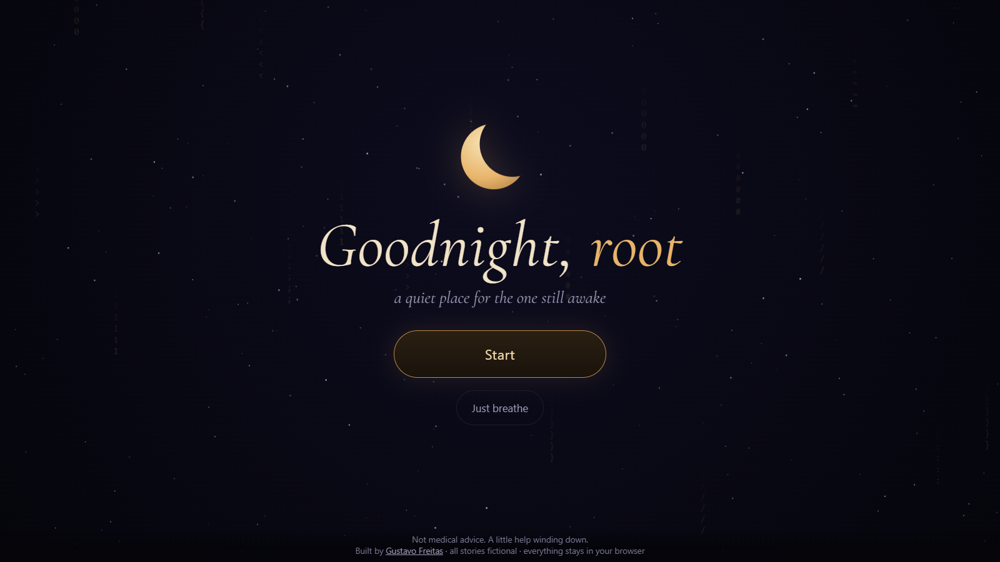
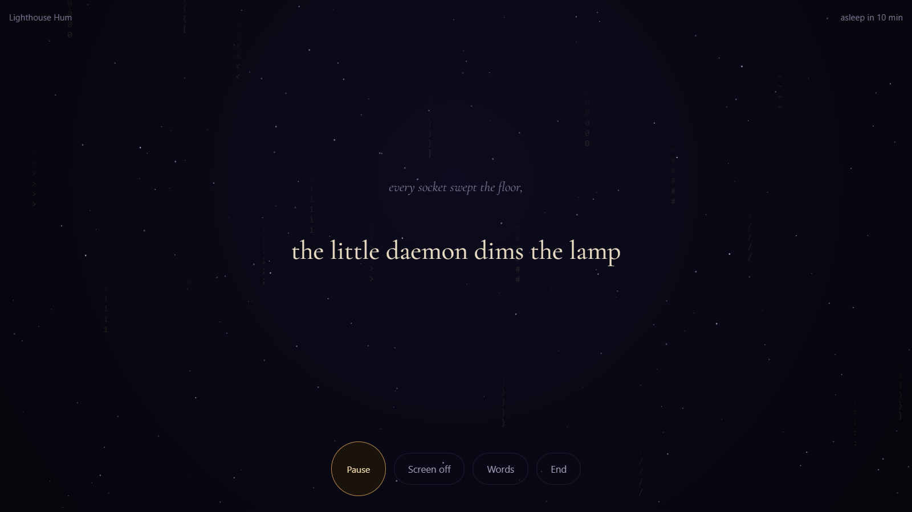

# GOODNIGHT, ROOT

Bedtime stories and lullabies for the engineer who can't sleep: soft voice, soft sound, and a timer that fades the whole night out.

**[Live demo](https://tootenramen.github.io/Goodnight-Root/)**

## What you can do
- Pick one of **6 original bedtime stories** (a lost little packet, a firewall counting sheep, a server room humming itself to sleep...) or **3 lullabies** with a synthesised music box.
- Hear it read slowly in your browser's own voice (auto-picks Natural / Online / Neural voices; choose any you like), with quiet, fading subtitles.
- Add a bed of **rain on the roof, server-room hum, or a slow heartbeat pad**, each with its own volume.
- Set a **sleep timer** (10-60 min or end of story). Sound and voice fade over the final minute, then the screen goes to a near-black goodnight.
- Try a **4-7-8 breathing guide** (a relaxation exercise, not medical advice), dim the screen, or turn it off completely. Space pauses and resumes.

## How it works
Everything is 100% client-side, one `index.html`, no network calls beyond an optional font. Speech uses the browser's `speechSynthesis`, chunked sentence by sentence with deliberate pauses and a keep-alive for the Chrome/Edge cutoff bug. Ambience and music are generated live with WebAudio, and never autoplay. Your choices stay in `localStorage`; nothing leaves your device. All stories are original and fictional. Not medical advice. A little help winding down.

**Skills this shows:** WebAudio synthesis, speech-API edge cases, a timer state machine with smooth fades, accessible calm UI (reduced motion, large targets), Playwright-verified logic.

Built by Gustavo Freitas - [LinkedIn](https://www.linkedin.com/in/gustavo-freitas-69b93910b/) - [more projects](https://github.com/Tootenramen)
